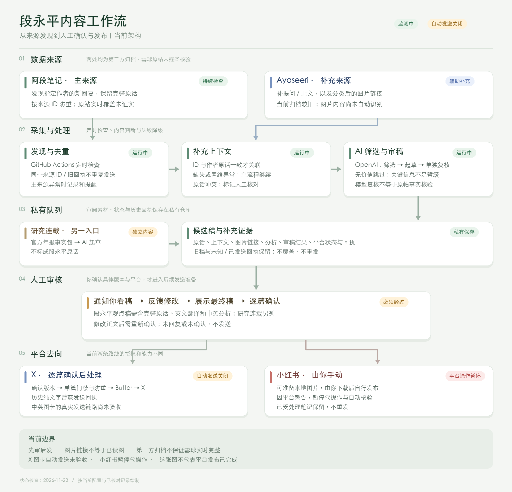

# 段永平观点整理：人机协作内容工作流

一个围绕公开投资观点的个人内容项目：发现新内容，补充提问背景，辅助生成双语解读，再由本人审核确认，整理成适合平台阅读的内容。项目重点是将信息处理、人工判断与发布边界连接起来。

## 工作流程

1. **发现与去重**：定时检查第三方内容归档，按来源标识去重，保留原文及来源信息。
2. **补充上下文**：结合另一归档来源补充提问、上下文和图片链接；来源不一致时留待人工核对，来源不可用时保留主流程。
3. **筛选与起草**：利用 AI 辅助筛选、起草和单独复核；关键信息不足时暂缓，模型复核不代替事实核验。
4. **人工审核**：本人查看草稿、提出修改，确认具体版本和目标平台。未确认不发送；正文修改后重新确认。
5. **平台处理**：X 方向准备中文原话、英文翻译及中英分析；小红书图片由本人下载后自行决定是否手动发布。

另有独立的商业研究连载，以公开年报等材料为依据，不标为段永平原话。

## 实现与边界

- 使用 GitHub Actions 定时调度，结合 OpenAI 进行内容筛选、起草与复核；私有队列保存候选稿、审核状态和回执，按来源及发送记录去重。
- 补充来源用于增加上下文和图片链接，不能保证覆盖雪球原站的所有新内容；图片链接也不代表图片内容已经被识别。
- 状态截至 2026 年 11 月 23 日：内容监测和初稿处理在运行，自动发送关闭。X 历史纯文字内容有发送回执，中英图卡自动发送链路尚未完成真实验收。
- 小红书此前提示涉及 AI 托管行为，现已暂停平台代操作和自动核验。平台展示及可见性以平台当前状态为准。

## 内容示例

- [X 账号：@mikelee2904](https://x.com/mikelee2904)
- [X 历史作品示例](https://x.com/mikelee2904/status/2122593854553473303)
- [小红书历史作品示例：《行业成长不等于优势稳固》](https://www.xiaohongshu.com/explore/6afac935000000002a029f8d)

以上作品链接曾于 2026 年 11 月 17 日核验；当前可见性未重新核验。该仓库仅展示项目架构和说明，不包含私有运行数据或凭据。
